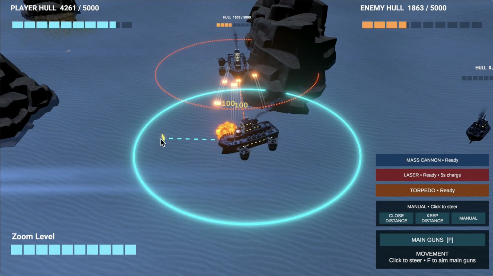
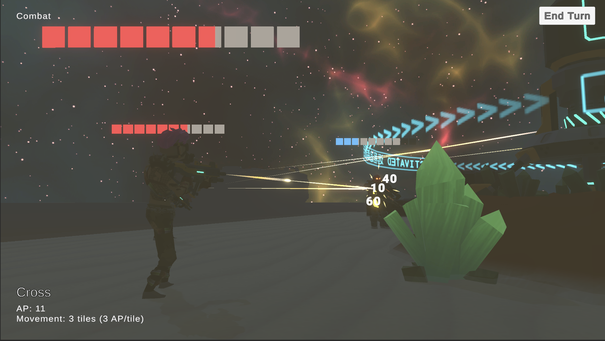

# Unity Semantic Bridge (USB)


A Unity MCP Bridge built for agents working alongside you in a live Editor session — not just querying a static project. Token-efficient tools give your agent visibility into what changed in the scene while you were both working in it.

**Note: Unity Semantic Bridge is optimized for projects that use uGUI and URP (Universal Render Pipeline). If your project uses UI Toolkit, HDRP or BiRP use the official Unity CLI instead**

## What's New

**October 17, 2026: Tool cleanup**
- **Removed** `notify_unity` and `set_play_mode`. Use `enter_play`/`exit_play`, which wait for the transition to finish and survive domain reloads.
- **Merged** `get_gameobject_tree` into `get_scene_hierarchy`. To walk a character's skeleton, pass the character as `root_instance_id` with `prune_skinned=False` and a deep `depth`. Rooted queries also now honour `depth` below the root; before, they returned only the root node.
- **Merged** `get_component_inspector_values` into `inspect_gameobject`. Pass `component` to read one component's Inspector values, or omit it to read every component.
- **Removed** `get_urp_pipeline_settings`. Its data is in `get_project_settings(sections=["rendering"])`.
- **Removed** `diagnose_lighting_issue` and its LightingAgent subagent, so no tool needs an LLM API key any more. Agents run the diagnosis themselves: `get_lights_affecting_object` now describes the steps (lights in range, URP rendering path and light limits, renderer settings, screenshot).

**October 15, 2026: Multi-Editor support**
- **Several Unity Editors at once.** Each project now has its own bridge ports (defaults 1073/1074), set in **Tools > Unity Semantic Bridge** and stored per user in `UserSettings/`. Register the same MCP server once per project under different names (for example `unity-semantic-bridge` and `unity-ap`), each with matching `--unity-port`/`--event-port`, for example a game project on 1073/1074 and an asset-library project on 1075/1076. See [several Unity projects at once](docs/installation.md#several-unity-projects-at-once).
- **Several agent sessions on one Editor.** Every MCP server attached to an Editor now receives its events, so `get_recent_unity_events` works in each agent session, not only the first. See [several agent sessions on one Editor](docs/installation.md#several-agent-sessions-on-one-editor).
- The listener's auto-start after domain reloads is now per Editor, `GET /health` reports which project answers, and connection errors name the URL and ports to check.
- **Background refreshes.** `refresh_assets` now completes in an Editor that is hidden or behind other windows: refresh, compile and domain reload finished in 11 seconds in a hidden Editor, which previously waited until you clicked back into Unity.

## Showcase

Made with USB:

[Battle Stations Next](https://youtu.be/Uv087lF27nM) - 3D Modernization of a classic Facebook Flash game from 2008. Playable demo on Unity Play [here](https://play.unity.com/en/games/5d00abe6-9643-4dcc-ae22-3142da1ab4fa/battle-stations-next-prototype-01)



[Nuclear Knights](https://youtu.be/6_YeEH3oKGs) - Turn based tactics in a Wasteland like setting




## Features

- Optimized scene heirarchy query and gameobject inspection tools with workflow hints for agents - more token efficient than official Unity CLI tool
- In Editor connection status and auto reconnect through domain reloads. 
- Not tied to Unity Licensing - Runs 100% local. No need to reauthenticate when token expires
- Dedicated tools for agent to see human actions and changes
- Dedicated tools for working with Scriptable objects (error prone if agent uses bash to work SOs directly)
- Dedicated tools for uGUI. Makes uGUI accessible for agents to create a hierarchy, set layout properties, assign references, and inspect the result
- Bounded batch inspection and property edits with dry runs, expected-value checks, stale-reference protection, and grouped Undo
- Read-only prefab comparisons with component filtering and structured numeric values that preserve imported precision
- In Editor MCP log so you can see what tools are called
- Dedicated Lighting tools for URP projects

## Prerequisites

- Unity 2022.3–6.3.
- [Git](https://git-scm.com/) on `PATH` and [uv](https://docs.astral.sh/uv/getting-started/installation/) for Python setup.

## Installation

Install both the Unity package and the Python MCP server:

1. In Unity, open **Window > Package Manager > + > Add package from Git URL**
   and paste:

   ```text
   https://github.com/Programalyst/unity-semantic-bridge.git?path=/com.gamenami.unity-semantic-bridge
   ```

2. Clone the matching Python server and install its dependencies:

   ```sh
   git clone https://github.com/Programalyst/unity-semantic-bridge.git
   uv --directory unity-semantic-bridge/mcp-editor-bridge sync --locked
   ```

3. Register the server with your MCP client. For Codex, replace the path below
   with your clone's absolute path:

   ```sh
   codex mcp add unity-semantic-bridge -- uv --directory "/absolute/path/to/unity-semantic-bridge/mcp-editor-bridge" run main.py
   ```

   [Other client configurations](docs/installation.md#clients-using-json-configuration).

4. In Unity, open **Tools > Unity Semantic Bridge > Start HTTP Listener**, then
   start or reconnect your MCP client. The client launches Python over stdio;
   Python connects to Unity on port 1073 by default. To run the bridge in several
   Editors at once, give each project its own ports; see
   [several Unity projects at once](docs/installation.md#several-unity-projects-at-once).

Commit both `Packages/manifest.json` and `Packages/packages-lock.json` to share
the installation. Keep your MCP client's local clone path out of shared settings.

For upgrades, local-to-Git migration, or bridge development using **Add package
from disk**, see the [installation reference](docs/installation.md). Do not commit
personal absolute package paths.

## Available Tools

**Human-Agent Cowork**
- `get_recent_unity_events` — Returns Unity Editor events (`hierarchy`/`selection`/`play-mode`/`console`/`objectChanged` via `ObjectChangeEvents.changesPublished`) pushed since a time window — use to see human edits, `add_component`/`remove_component`/`set_field_values` etc.

**Project & Settings**
- `get_project_settings` — Returns Unity Project Settings as JSON. Selectively fetch `core` (Unity version, build target), `rendering` (URP asset, color space, MSAA), `input` (Input Handling, `inputactions` assets), `ui` (uGUI vs UI Toolkit counts), `scripting` (API level, define symbols, backend), `tags_layers`. The `editor_prefs` section reports the current Interaction Mode, stored idle time, and restore availability; these are user-level Editor preferences.

**Scene & GameObject Inspection**
- `get_scene_hierarchy` — Returns the scene as a list of GameObjects with paths and instance IDs. Usually the first tool to call. Supports depth limiting, a node cap with truncation reporting (for large scenes), optional filtering to only main-camera-visible objects, and `root_instance_id` subtree queries. Objects with a `SkinnedMeshRenderer` are skipped by default; pass `root_instance_id` with `prune_skinned=False` and a deep `depth` to walk a character's rig.
- `inspect_gameobject` — Serialized field values visible in the Inspector for every component on a GameObject, or only the one named by `component` (live Editor values via `ComponentInspector`; expands `RigBuilder`/`Rig`/`*Constraint.m_Data`/`Transform.m_LocalRotation` as structured `quat`+`euler`).
- `get_component_code` — Locates and returns the full C# source for a named component (`MonoScript` via `AssetDatabase`).
- `get_physics_layers` — Physics layer collision matrix (`Physics.GetIgnoreLayerCollision`).

**Batch Inspection & Property Edits**

- `acquire_editor_references` — Converts 1–64 live GameObject/component instance IDs into opaque references for `semantic_batch`. Verify the returned identities before editing; reacquire references after reloads, scene/Prefab Stage changes, deletion, or cache eviction. Asset IDs are rejected.
- `semantic_batch` — Runs 1–64 ordered operations with unique IDs: either all `inspect` or all `set_fields`. Inspections return structured properties or component identities and continue after individual errors. Edits support `dry_run`, exact expected-value preconditions, whole-request preflight, execution-time revalidation, and one named Undo group within one editable scene/Prefab Stage (Auto Save off). Execution stops on the first failure and reports skipped operations; partial application is possible and Undo grouping is not atomic. Optional `limits` bound work and response size with explicit truncation. No implicit saves or automatic mutation retries.
- [Usage, limits, failure semantics, and measured request savings](docs/semantic-batches.md).

**Scene & GameObject Authoring (Hierarchy & Rigging)**
- `create_gameobject` — Creates a new `GameObject` (`new GameObject(name)`) with `Undo.RegisterCreatedObjectUndo`, optional `parentInstanceId` via `SetParent(parent,false)`, and optional `localPosition`/`localRotation` (`{x,y,z,w}` or `{euler}`) / `localScale`. Returns `{instanceId,path}`.
- `duplicate_gameobject` — Duplicates a hierarchy via `Instantiate` + `Undo.RegisterCreatedObjectUndo` (use for cloning whole rig layers, e.g. `Rig Layer (Rifle Idle)`). Returns `{instanceId,path}`.
- `set_parent` — Reparents via `Undo.SetTransformParent` (or `RegisterCompleteObjectUndo`+`SetParent` when `keepWorldPosition:true`). Pass `null` to unparent to root.
- `delete_gameobject` — Deletes a `GameObject` via `Undo.DestroyObjectImmediate` (supports Undo).
- `copy_component` — Deep-copies a component via `Undo.AddComponent` + `EditorUtility.CopySerialized` (required for Animation Rigging `Constraint.data` structs where `m_Data: [Generic]` cannot be rebuilt via `set_field_values`). Returns `{targetComponentIndex,targetInstanceId}`.
- `add_component` — Adds a component by `instance_id` (`Type.GetType` + assembly fallback, respects `allowDuplicate`).
- `remove_component` — Removes a component by `instance_id` (`Undo.DestroyObjectImmediate`).
- `set_field_values` — Sets one or more serialized field values via `SerializedObject`/`FindProperty` + `Undo.RecordObject` (supports primitives, enums as strings, `Vector2/3`, `Quaternion`, `Color`, `ObjectReference` as `instanceId`, `Generic`/`Array` for `RigBuilder`/`Constraint` data).

**uGUI Authoring & Diagnostics**
- `author_ui` — Create, lay out and wire Canvas/Image/Button/TMP hierarchies in one undoable batch.
- `inspect_ui` / `raycast_ui` — Inspect layout, visibility and actual input hits, including camera-mask-hidden UI.
- `undo_ui_batch` / `save_ui_context` — Undo a batch or explicitly save its scene/prefab.
- [Usage and examples](docs/ugui-authoring.md).

**Assets & ScriptableObjects**
- `find_unity_files` — Finds assets in Unity via `AssetDatabase.FindAssets` (`t:Prefab`, `l:Label`, etc.), default `folders:['Assets']`.
- `inspect_prefab_assets` — Reads selected serialized property paths from matching components throughout 1–32 imported prefab assets under `Assets/` or `Packages/`. Resolves variants, nested prefabs, and inactive objects; returns sibling-indexed hierarchy paths, component identities/indices, and typed numeric values without display rounding. Optional `limits` bound traversal, expansion, response size, and cooperative execution time, with explicit truncation. Reads imported asset values rather than unsaved Editor overrides, without instantiating, selecting, modifying, reimporting, or saving assets/scenes.
- `inspect_model_asset` — Inspects an imported FBX/OBJ or other `ModelImporter` asset by path. Reports mesh IDs, bounds, geometry counts, imported hierarchy/transforms, importer scale/axis settings, material slots, and outgoing dependencies. `include_details=True` adds submesh and importer details. Read-only; see [coordinate definitions and examples](docs/model-inspection.md).
- `bake_layout` — Reads the active scene back into compact grid-layout JSON (`{"v":1,"size":[w,h],"pieces":[[localId, prefabGuid, x, y, rot]],"deploy":[[x,y]],"decor":[]}`) through the game's `IGridRulesAdapter` (`Runtime/Layout/`). Off-grid rotation, scale or position, off-board and non-prefab blockers are reported, never snapped; also lists cells where the layout disagrees with the game's own occupancy bake. Optional `path` writes the JSON under `Assets/`. Edit Mode only. The matching compiler is `LayoutCompiler` (Editor API). See [grid layouts](docs/grid-layouts.md) for the format, the USB/game split and a flow diagram.
- `generate_asset_catalog(catalog="level")` / `describe_level_cards` — Level catalog cards for prefabs (role, cover, visual and collider bounds at root scale 1, `placementScale`, root rotation) in `AssetCatalog/level-catalog.json`, keyed by GUID; `describe_level_cards` measures given prefab paths and their footprint for a cell size without writing anything. Roles and scales can be overridden in `AssetCatalog/LevelCatalogOverrides.json`. See [level catalog](docs/level-catalog.md).
- `find_asset_references` — Finds assets/scenes referencing a specific asset path (`AssetDatabase.GetDependencies`).
- `get_project_tree` — Project folder structure from a path (`AssetDatabase.GetSubFolders` + direct-file filter).
- `write_unity_script` — Creates/overwrites a C# script (`Assets/...cs`) and triggers recompilation (`AssetDatabase.ImportAsset`/`Refresh`, `CONFIRM_REQUIRED` pattern).
- `create_scriptable_object` — Creates a `ScriptableObject` asset atomically without `write_unity_script`: `Type.GetType` + assembly fallback, `ScriptableObject.CreateInstance`, field init via `SerializedObject` (primitives, enums as `"cross"`→`UnitId.cross`, `Vector3` `{x,y,z}`, `Object` refs as `instanceId`/`guid`/`{fileID,guid}`), `Undo.RegisterCreatedObjectUndo` + `AssetDatabase.CreateAsset/SaveAssets/Refresh`. Validates `Assets/` + `.asset`, parent folder exists, `ScriptableObject` subclass, `CONFIRM_REQUIRED` on overwrite. Returns `{instanceId,guid,path}`.
- `delete_asset` — Deletes an asset via `AssetDatabase.DeleteAsset` (supports Undo, validates `Assets/`).
- `refresh_assets` — No-argument asset refresh after external disk edits; Unity decides whether compilation/reload is needed. See [refresh workflow](mcp-editor-bridge/README.md#refreshing-external-file-edits).
- `get_compilation_status` — Non-blocking snapshot (`PENDING`/`SUCCESS`/`FAILED`/`NO_COMPILATION`/`UNKNOWN`) — poll after `write_unity_script` or `refresh_assets`.

**Editor & Runtime**
- `get_screenshot` — Captures `game` (`Camera.main`) or `scene` (Scene view) as JPEG; `scene` can `Frame` a `focus_instance_id` bounds before capture.
- `open_scene` — Opens a scene by project-relative path. Default `dirty_policy=fail` refuses unsaved changes; `save` saves first. Returns scene path + dirty state.
- `enter_play` / `exit_play` — Request Play/Edit Mode and wait for the idle terminal state (or a timeout carrying state); survives domain reload via `poll_play_state`.
- `poll_play_state` — `{isPlaying, transitioning, isCompiling, isUpdating, pendingOp, interactionMode}` snapshot with no side effects.
- `invoke_menu_item` — Execute one Editor menu item by exact path; unknown paths are not-found errors.
- `invoke_static` — Invoke one public static zero-arg method by exact type/method names; returns the value as string (`ok` for void).
- `set_editor_throttling` — `no_throttling` keeps the Editor tick rate un-throttled while unfocused for long sessions; `restore`/`default` afterwards.
- `get_console_logs` / `clear_console_logs` — Read last 10 errors/warnings via `LogEntries` reflection or clear (`LogEntries.Clear`).

**Lighting Diagnostics**
- `get_lights_affecting_object` — Lights within range of a target object using actual bounds distance, per-light `type`/`intensity`/`range`/`cullingMask` (uses `GetLightsAffectingObject`). URP rendering path and light limits are in `get_project_settings(sections=["rendering"])`.


## Known Limitations (for Agents using this tool to read)

- **Unity instance IDs last as long as the object, within one Editor session.** Script recompiles, domain reloads, entering or exiting Play Mode and asset reimports (even with changed content) keep them. Reopening or reloading a scene gives its objects new IDs (asset IDs survive), as does deleting and recreating an object. Reimporting the open scene's own file, such as a recursive reimport of its folder, reloads the scene a few seconds later. After a scene change, re-run `get_scene_hierarchy` before reusing an ID from an earlier call. `acquire_editor_references` handles are separate and must be reacquired after any reload.
- **The Editor connection is single-flight.** Only one MCP request is processed at a time; overlapping calls queue rather than run concurrently, since Unity's Editor-side message handling is inherently serial.
- **A background Editor may still be slower than a focused one.** `refresh_assets` now refreshes, compiles and reloads in a hidden Editor without refocusing it. Other work can still be throttled by Unity's Interaction Mode: `poll_play_state` reports `interactionMode`, and unless the user prefers otherwise, run Editor-driving sessions under `set_editor_throttling("no_throttling")` and restore it afterwards.

## Reusable test project

[`TestProject`](TestProject/README.md) consumes the local package and enables its
EditMode tests. Run `bash scripts/test-unity.sh` from the repository root to prepare
TMP/mesh fixtures and run the suite with Unity 2022.3.62f3. Generated resources,
Editor caches and results are ignored. The test-host README documents known
opt-in refresh checks and how to select focused suites.

## Batch operations and prefab inspection

Use `inspect_prefab_assets(paths, component, properties, limits?)` to compare
selected serialized fields across resolved prefab hierarchies in one read-only
request, with structured numeric values and explicit truncation.

Use `acquire_editor_references(instance_ids)` followed by `semantic_batch` for
bounded Editor inspections or property edits. Edits support dry runs, expected
values, stale-reference checks and one named Undo group; partial application is
possible. See [usage, limits, failure semantics and validation](docs/semantic-batches.md).

## Imported model inspection

Use `inspect_model_asset(path, include_details=False)` to read mesh IDs, bounds,
geometry counts, imported transforms, importer scale/axis settings, material slots
and outgoing dependencies without changing assets or scenes. See
[model inspection and deletion-reference assessment](docs/model-inspection.md)
for coordinate-space definitions, examples and tests.
