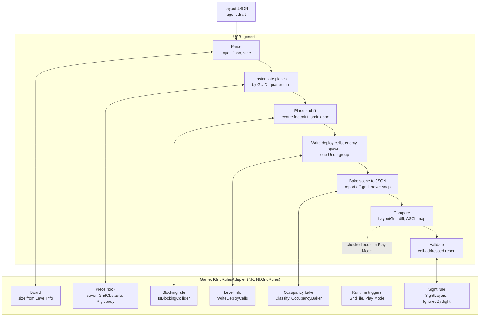

# Grid layouts: apply and bake

USB can turn a compact layout draft into scene objects (`LayoutApplier`), read
any scene back into the same draft (`LayoutBaker`, the `bake_layout` MCP tool), and
validate either (`LayoutValidator`, `LayoutSceneValidator`). USB
owns the generic parts. The game supplies its grid rules through one interface,
`IGridRulesAdapter`. Nuclear Knights' `NkGridRules` is the first implementation.
The JSON is the agent's working copy of a level; apply writes it into the scene and
the level asset, which stay the runtime sources of truth. When they disagree, re-bake
the JSON from the scene; a stale JSON is never trusted or merged (plan decision D9).
Background and later phases are in the
[asset intelligence plan](asset-intelligence-plan.md).

## Layout JSON

```json
{"v":1,"size":[12,12],
 "pieces":[["wall_n","215a18edfee7f4f2eaaa7fe488cea3ab",3,6,0]],
 "deploy":[[1,1],[2,1],[1,2]],
 "enemies":[["raider1","42e57b125c17a4bdab86d7879003f0e8","b0388b2498f234e91a73a49eec10add1",10,11,180]],
 "decor":[]}
```

- `size` must equal the game's board size.
- Each piece is `[localId, prefabGuid, x, y, rot]`: the prefab asset GUID, the
  min-corner cell of its footprint, and 0–3 clockwise quarter turns **on top of the
  prefab root's own rotation** (rot 0 places the prefab as authored).
- `pieces` block movement; `decor` never does. `deploy` replaces the level's deploy
  cells, in order.
- Each enemy is `[localId, profileGuid, visualGuid, x, y, facing]`: the game's unit
  profile and visual asset GUIDs, the spawn cell, and the facing in degrees (yaw:
  0 = +y, 90 = +x). `enemies` replaces the level's spawns, in order. Levels store no
  ids, so a bake names spawns `enemy1`, `enemy2`, … and `LayoutDocument.Diff` compares
  spawns by order, ignoring ids.
- Parsing is strict: unknown keys, malformed GUIDs, duplicate ids (shared by pieces,
  decor and enemies) and rotations outside 0–3 are errors, so a typo fails instead of
  applying a different level. Facing may be any number; the encounter validator
  checks it.

## Who owns what

| | USB (generic) | Game adapter (NK: `NkGridRules`) |
|---|---|---|
| Data | `Cell`, `LayoutDocument`, `LayoutJson` (`Runtime/Layout/`) | |
| Rules | `GridRules` as data; `LayoutGrid` applies them (neighbours, corner rule, orthogonal cover, diffs, ASCII map) | Supplies the values: cell size, 8-way, no corner-cutting, orthogonal cover |
| Board | | `TryGetBoard`, `CellToWorld`, `WorldToCell` (size from Level Info, origin, floor height) |
| Pieces | `LayoutApplier`: instantiate, rotate, scale and size from the catalog card (or measure), place, fit colliders, one Undo step | `DescribeCover`, `ConfigurePiece` (piece hook), `IsBlockingCollider`, `GroundLift` |
| Cards | `LevelCardSource`: a reviewed piece's level catalog card, built on demand from the prefab and `AssetCatalog/LevelCatalogOverrides.json` | Commits the overrides file |
| Reading scenes | `LayoutBaker`: pieces, decor, off-grid reports, occupancy diff | `Classify` (blocker, decor, ignore), `BakeOccupancy` |
| Level data | Writes/reads deploy cells and enemy spawns through the adapter | `ReadDeployCells`, `WriteDeployCells`, `ReadEnemySpawns`, `WriteEnemySpawns` (resolves GUIDs to the game's asset types) |
| Validators | `LayoutValidator` (pure: structural, encounter, reachability, consistency), `LayoutReport`; `LayoutSceneValidator` (Editor: physics tier) | Nothing new: rules, occupancy bake and sight rules above |
| Sight | Consistency check: sight colliders without obstacles | `SightLayers`, `IgnoredBySight` |

`Runtime/Layout/` uses no UnityEngine types except `IGridRulesAdapter.cs`. The
runtime assembly is auto-referenced, so a game without asmdefs implements the
interface in Assembly-CSharp. USB Editor finds the single implementation through
`TypeCache`, so USB has no apply-time reference to the game. The adapter restates
rules the game already has. Keep a game-side harness that checks the restatement
against the real code; NK's is **Tools → Grid Combat → Validate Layout Round Trip**.

## Flow



Solid links are USB calling the adapter. The dotted link is the Play Mode check:
the game's own runtime occupancy must equal the layout.

## Where pieces' cards come from

Since Phase 4c, apply and bake take a piece's scale, lift, footprint and cover from its
[level catalog card](level-catalog.md) when it has one. `LevelCardSource`
(`Editor/Layout/LevelCardSource.cs`) supplies them; `Apply` and `Bake` take one as an
optional last argument and default to `LevelCardSource.ForProject()`:

- A game project commits only the overrides file (`<Project>/AssetCatalog/LevelCatalogOverrides.json`;
  generated catalogs there are gitignored, NK included). So cards are **built on demand**
  from the prefab and that file, by the same `LevelCatalogGenerator.BuildCard` the catalog
  run uses (isolated `LoadPrefabContents`, never the open scene), once per prefab per
  apply or bake. Nothing generated has to be kept fresh, and an overrides edit takes effect
  on the next apply.
- Only **reviewed pieces** have a card: a per-piece entry in the overrides file (by GUID or
  catalog id). Family rules alone don't count, and prefabs without an entry (NK's own
  Wall SF, Wall SF (half), Grid Crystal Patch) are measured on the instance at their prefab
  scale, exactly as in Phase 2.
- A missing overrides file means no cards; a malformed one stops apply and bake before
  the scene is touched. Tests and tools can pass `LevelCardSource.From(cards)`,
  `ForOverrides(overrides)` or `None`.

## How the applier instantiates pieces

`LayoutApplier.Apply(document, scene, adapter, cards)` (`Editor/Layout/LayoutApplier.cs`):

1. **Checks first.** It refuses during Play Mode and when the layout's size differs
   from the board. It resolves every GUID (`AssetDatabase.GUIDToAssetPath`, then
   load, then check it is a prefab) and throws once, listing all missing pieces,
   before touching the scene. Pieces moved between projects must keep their GUIDs.
   Then it builds the pieces' cards.
2. **Root.** It opens one Undo group, removes any existing `[Generated Layout]` root
   (with Undo), and creates a fresh one with `Pieces` and `Decor` children.
3. **Per piece with a card** (`LayoutApplyResult.CardCount` counts them):
   1. The live prefab instance (named by local id) gets the quarter turn × the prefab
      root's own rotation and the card's **`placementScale`** as its root scale.
   2. Footprint: `LevelCards.Footprint(card, cellSize, blocking)`, from the card's
      collider bounds for a blocker and its visual bounds for decor, or its
      `footprintOverride` (claimed cells; the piece may overhang them).
   3. Position: the card's bounds centre goes to the footprint's centre, as below. The
      pivot stands at the floor + the card's **`lift`**, plus the adapter's
      **`GroundLift`** for ground-role cards (NK: 0.25 m for the whole road kit, so road
      and sidewalk tiles stay level and clear the terrain).
   4. Blockers only, before the piece hook: every solid collider (enabled, not a
      trigger) that reaches past the footprint inset by 0.1 m is fitted. Axis-aligned
      boxes are shrunk as below. Other shapes (Synty's mesh colliders, rotated boxes) are
      **disabled** and replaced by one box on a `Footprint Collider` child: their combined
      bounds clipped to the footprint inset, full height (`FIT_BOX` note). For a piece
      with a footprint override this is the box fitted to the claimed cells; for others
      it trims the piece's ends (a 2.02 m jersey barrier keeps 1.80 m), since
      any sliver in a neighbour cell would block it.
   5. Blockers only: the piece hook runs with the card's **`cover`** (`None` for
      movement-only blockers; the adapter's `DescribeCover` only when the card has no
      cover), then any blocking box the hook added is fitted, and a piece left without a
      blocking collider is reported.
4. **Per piece without a card:**
   1. `PrefabUtility.InstantiatePrefab` creates a live prefab instance, so later
      prefab edits carry through. It is named by local id.
   2. Rotation is the quarter turn × the prefab root's own rotation.
   3. Blockers only: the adapter reports cover (`DescribeCover`) and runs the piece
      hook (`ConfigurePiece`). NK leaves its own obstacle prefabs as authored and adds
      `GridObstacle` plus a kinematic Rigidbody to others.
   4. Measure: the blocking colliders' bounds for blockers, renderer bounds for decor.
      Bounds are taken in the piece's quarter-turn frame, relative to its pivot, with
      all scales applied. This comes after the hook, which may add the collider.
   5. Footprint: the size is rounded up to whole cells after a 5 cm tolerance; odd
      quarter turns swap width and depth.
   6. Position: the adapter gives the world centres of the footprint's first and last
      cells; the measured centre (not the pivot) is placed at their midpoint, at the
      adapter's floor height. Off-centre pivots are corrected this way.
   7. Blockers only: each axis-aligned `BoxCollider` that reaches past the footprint is
      shrunk to the footprint inset by 0.1 m per side, as a scene override on the
      instance. Other collider shapes that overhang are reported (`FIT_UNSUPPORTED`).
5. **Finish.** It derives the expected grid from the recorded footprints (reporting
   `OVERLAP`, `OUT_OF_BOUNDS`, deploy problems), writes enemy spawns and deploy cells
   through the adapter with Undo recorded on the level, registers the root for Undo and
   collapses everything into one step. Before touching the scene it checks that every
   spawn GUID names an asset; if anything still throws later (e.g. the adapter refuses
   a GUID of the wrong asset type), it destroys the new root and reverts the Undo group,
   so the previous root and level come back unchanged.

The result lists issues (where the scene may not match the layout) and notes
(deliberate adjustments, e.g. `FIT 3,6 wall_n/.: 1.00 x 3.91 m -> 1.00 x 3.80 m`, or
`FIT_BOX 6,8 tyre_heap: MeshCollider . (2.21 x 2.31 m) disabled; Footprint Collider box 1.80 x 1.80 m`).
Reapplying replaces only the generated root; hand edits to generated objects are
lost on the next apply.

## How the baker reads a scene

`LayoutBaker.Bake(scene, adapter)` and `bake_layout(path=None)`:

- Visits active outermost prefab instances. The adapter classifies each as blocker,
  decor or ignored. Decor wholly off the board is skipped silently.
- Each instance must be a quarter turn of its prefab's rotation, at its card's
  `placementScale` (the prefab's own scale when it has no card), with its footprint
  centre within 5 cm of cell alignment and inside the board. A card piece's footprint and
  centre come from its card (claimed cells for a footprint override), as apply placed
  it; others are measured. Height is not checked, so lifted and ground-lifted pieces
  bake back. Cover is the adapter's `DescribeCover` on the instance, so `None` stays
  apart from `Half` in the layout grid, the occupancy diff (`COVER`) and the map (`o`).
  Otherwise it is reported (`OFFGRID_ROTATION`, `OFFGRID_SCALE` naming the card's or the prefab's scale, `OFFGRID_POSITION`,
  `OFF_BOARD`) and left out; nothing is snapped. Blocking colliders outside any prefab
  instance are reported as `NOT_PREFAB`.
- Deploy cells and enemy spawns come from the level through the adapter. A spawn
  without a profile or visual asset is reported (`ENEMY_NO_ASSET`) and left out.
- It then runs the adapter's occupancy bake and lists cells where the layout's
  footprints and the game disagree (`EXTRA_BLOCK`, `MISSING_BLOCK`, `COVER`).
- `bake_layout` only reads, unless `path` is given; then it writes that one `.json`
  file under `Assets/`. It is refused during Play Mode.

## Validators

`LayoutValidator` (`Runtime/Layout/LayoutValidator.cs`) is pure C#. Each check returns
`LayoutIssue`s, printed as `CODE x,y message` with an `Error`, `Warning` or `Note` severity
(a note is for the record: reviewed content outside a rule; the header counts notes only when
there are some). `LayoutReport.Format(maxLines = 40, ascii = false)` lists errors, then warnings,
then notes, caps
the lines (`... N more lines not shown`), and on request appends the ASCII map
(`#` full, `h` half, `o` blocked, `.` open, `A` deploy, `E` enemy, `!` a unit on a
blocker, `-` open but unreachable). When the board has walls on cell sides the map is
drawn at double resolution with the outline characters between cells (`-`/`|` wall,
`w` window, `D` door, `+` where a wall meets a corner).

**Walls on cell sides** (plan Phase W; `GridRules.SideWalls`, which NK sets). A card with a
`walls` outline ([level catalog](level-catalog.md)) is a walled building: `LayoutGrid.Build`
claims its footprint without blocking it (a second building on a claimed cell is `OVERLAP`;
other pieces may stand inside), rotates the outline with the piece and puts each side on the
board on both cells it separates (`SetSide`, `SideAt`). `CanStep` refuses a straight step across
a wall or window and a diagonal past a corner where one meets (even without the corner rule),
`CoverSides` takes the better of the neighbour's blocker and the side's own wall, and
`DiffOccupancy` adds `WALL_MISSING`, `WALL_EXTRA`, `WALL_KIND` and `WALL_COVER`. An outline whose
size differs from the footprint is `OUTLINE_SIZE`. Without `SideWalls` a walled card builds as a
solid blocker. Reachability goes through doors with no extra code. Apply and bake writing the
game's wall component, and the wall validators, come later (Phase W3/W4).

| Check | Codes | Input |
|---|---|---|
| Structural | `OUT_OF_BOUNDS`, `OVERLAP` (one blocker per cell), `UNKNOWN_PIECE`, `DECOR_OUT_OF_BOUNDS` (warning); for scenes also the bake's `OFFGRID_*`, `OFF_BOARD`, `NOT_PREFAB` and the apply's `FIT_*`, `NO_BLOCKING_COLLIDER` | Document + footprints |
| Encounter | `DEPLOY_`/`ENEMY_OUT_OF_BOUNDS`, `DEPLOY_`/`ENEMY_BLOCKED`, `CELL_SHARED`, `FACING_RANGE` (outside 0–359), `FACING_OFF_AXIS` (warning: not one of the eight grid directions) | Occupancy grid, deploy, spawns |
| Reachability | `NO_DEPLOY`, `ENEMY_UNREACHABLE`, `POCKET` (warning, one per unreached region of open cells, at its lowest cell) | Breadth-first search from the open deploy cells with `LayoutGrid.CanStep` (the game's neighbour and corner rule) |
| Consistency | `MISSING_BLOCK` (a layout blocker without a game collider), `EXTRA_BLOCK`, `COVER`, `SIGHT_NO_OBSTACLE` (warning) | Layout grid, the game's occupancy bake, sight colliders |
| Scale | `OFFGRID_SCALE` (a card piece in a scene at another scale than its card's `placementScale`, on its cell, with its height at both scales), `HEIGHT_BAND` (a blocker's card height outside the game's band for the cover it gives, with a suggested Y scale; a **note** when its role and scale are both owner-approved overrides) | Placed card pieces (`PlacedCard`), the adapter's `GridRules.CoverHeights` |
| Plausibility (warnings) | `ROLE_LAYER` (a ground/decor card in `pieces`, or a blocking role in `decor`), `GROUND_RUN` (a 4-connected run of ground cells reaching no board edge), `GROUND_OVERLAP` (two ground pieces on one cell z-fight), `BUILDING_FRONT` (front faces the board edge or only blocked cells), `BUILDING_NO_FRONT` (note: no front known) | Placed card pieces, occupancy grid |

Pieces must sit on whole cells (plan decision D10). Relaxing that for decor or
overhanging blockers comes later.

**Scale and plausibility** (Phase 4d) need cards, so they cover pieces with a card only
(`LayoutValidator.Scale`, `LayoutValidator.Plausibility`, pure; apply and bake fill
`LayoutApplyResult.Cards` / `LayoutBakeResult.Cards` with `PlacedCard`s):

- **Bands from the game.** `GridRules.CoverHeights` (`CoverHeightBands`: `HalfMin`, `HalfMax`,
  `FullMin`; USB's defaults: up to 1.2 m, from 2 m) are the target heights, also used by catalog
  role detection. NK sets half 0.9–1.2 m, full from 1.6 m. The check uses the cover the piece
  **gives as placed** (card cover, or the adapter's when the card has none), so a movement-only
  blocker (cover `None`) may be any height and decor is not checked. Heights compare with 5 mm slack.
- **Height** is the card's `height` (bounding-box top above the floor at `placementScale`,
  `lift` included). The suggested Y scale only scales the part above the lift, is rounded to
  three decimals towards the band, and the line offers the other cover where the height fits it
  (`... ; Y scale 0.805 (now 1) makes it 1.20 m, or give it Full cover`). When the lift alone
  is above the band it says to lower the lift.
- **Reviewed truth.** A card whose `roleSource` and `scaleSource` are both `override` was approved
  by the owner; outside its band it is a `HEIGHT_BAND` note, since a box top can overstate thin
  parts (NK's Fence_04 at 1.23 m: its end posts). A reviewed role with an unreviewed scale is
  still an error.
- **Off-scale scene pieces.** The bake leaves a card piece at another scale out of the layout
  (its `OFFGRID_SCALE ~x,y` line stays in `LayoutBakeResult.Issues`); `ValidateScene` replaces
  that line with the scale check's cell-addressed one, which adds the heights and whether the
  scene height leaves the band (`OFFGRID_SCALE 4,3 jersey: scale (1, 1.5, 1) differs from its
  card's placementScale (1, 1, 1): 1.40 m tall here, 0.93 m at the card's scale (outside the
  half-cover band 0.90-1.20 m); ...`). Applied layouts are at card scale by construction.
- **Ground runs.** Road and sidewalk tiles (card role `ground`) sit on the adapter's
  `GroundLift`, so a free tile edge shows the step: each 4-connected run of ground cells must
  touch the board edge (or hang past it). Ground tiles on the same cell z-fight (`GROUND_OVERLAP`).
- **Building fronts.** A building's card `front` (the model's +Z, or the overrides file,
  [level catalog](level-catalog.md)) is turned by the layout rotation; the row of cells outside
  that side must hold at least one open cell (open or road; the occupancy grid decides). A front
  off the board or facing only blockers is a warning; a building without a known front is a
  `BUILDING_NO_FRONT` note (only a building with a tilted root has none).

`LayoutSceneValidator` (`Editor/Layout/`) adds the physics tier:

- `ValidateApplied(document, applyResult, scene)`: structural, encounter and
  reachability on the draft's footprints, the apply's placement issues, scale and
  plausibility on the applied card pieces, the adapter's occupancy bake issues, then consistency.
- `ValidateScene(scene, bake = null)`: any scene. The bake's report lines are the
  structural tier (card pieces' `OFFGRID_SCALE` replaced by the scale check's); encounter and
  reachability run on the game's own occupancy bake, because pieces the layout cannot express
  still block at runtime; scale and plausibility run on the baked card pieces.
- `GatherSight`: for each board cell, an overlap box across the sight band (0.5–2.5 m
  above the floor) on `SightLayers`, triggers and `IgnoredBySight` colliders excluded.
  Colliders are grouped by their outermost prefab instance (or GameObject); a group
  is an obstacle when a collider is a blocking collider or the instance classifies as
  a blocker. Others become `SIGHT_NO_OBSTACLE`, e.g. NK GridBattle's sandy rock sets.
  Non-convex mesh colliders are found only where their surface crosses a cell.

NK's checks against real content are in **Tools → Grid Combat → Validate Layout
Reports**: the NK pieces and catalog pieces fixtures give clean reports, broken JSON fixtures report exactly
their expected lines (`scale-plausibility.layout.json`: Fence_04's note, a building facing the edge,
one facing only blockers, one without a front, a mid-board road run with an overlapping sidewalk tile),
a card piece without an approved scale is a `HEIGHT_BAND` error, a rescaled card piece gives the
cell-addressed `OFFGRID_SCALE`, and a GridBattle report equals a recorded fixture.

## Current limits

- Pieces without a reviewed card are still measured on the instance at their prefab
  scale (the Phase 2 path, `PieceGeometry`). A per-piece scale in the layout JSON (plan
  §3) is not in the schema yet.
- `apply_layout` and `validate_layout` are not MCP tools yet (Phase 5); call `LayoutApplier.Apply`
  from an Editor menu or script (NK: **Tools → Grid Combat → Apply CatalogTest
  Layout**).
- For pieces without a card only axis-aligned box colliders are fitted; others are
  reported (`FIT_UNSUPPORTED`). Card pieces replace them with a fitted box, which needs a
  root turned in quarter turns. The applier does not check that a
  collider touches every footprint cell; the consistency check (`MISSING_BLOCK`) and
  the bake's occupancy diff catch that.
- Plausibility is kept to what cards and the layout decide: ground runs do not know which tile is a
  straight, corner or end, so a run that reaches the edge passes even if its tiles don't line up; and a
  building's front is its model's +Z unless the overrides file says otherwise, so a pack modelled
  another way needs `front` overrides.

## Tests

- `Tests/Editor/LayoutModelTests.cs`: NUnit tests for the parser (enemies included),
  serializer, diffs, footprints, neighbour/corner rule, cover and ASCII map.
- `Tests/Editor/LayoutApplierCardTests.cs`: apply and bake in a temporary scene with a
  small test adapter: card scale and the bake's `OFFGRID_SCALE` against it, lift and a
  footprint override with its fitted box (occupancy blocks only the claimed cell), ground
  lift, card cover `None` reaching the hook and staying apart from `Half`, and pieces
  without a card (rules alone give none) measured as before.
- `Tests/Editor/LayoutScalePlausibilityTests.cs`: the scale and plausibility checks (bands, the
  reviewed note, suggested scales with a lift, off-scale scene pieces, wrong layers, ground runs and
  overlaps, building fronts with rotation, notes in the report), role detection with a game's
  bands, and fronts from the model's forward or the override.
- `Tests/Editor/WallOutlineTests.cs`: walls on cell sides: the outline picture (parsing, errors,
  rotation with door points, JSON), the step and corner rule, wall cover, diffs and the double-resolution
  map, building claims and rotated walls in `Build`, reachability through a door, and the overrides and
  card fields. `Tests/Editor/WallOutlineSuggesterTests.cs`: the suggester on a box-built room.
- `Tests/Editor/LayoutValidatorTests.cs`: deliberately broken layouts, each with the
  exact report line it must produce, plus corner-rule sealing, report capping and the
  map, and the consistency check. Run them through `TestProject`:
  `scripts/test-unity.sh -testFilter "Gamenami.UnitySemanticBridge.Editor.Tests.LayoutModelTests|Gamenami.UnitySemanticBridge.Editor.Tests.LayoutValidatorTests|Gamenami.UnitySemanticBridge.Editor.Tests.LayoutApplierCardTests|Gamenami.UnitySemanticBridge.Editor.Tests.LayoutScalePlausibilityTests"`.
- `mcp-editor-bridge/tests/test_layout_tools.py`: `bake_layout` registration.
- Game side (NK): **Validate Layout Round Trip** compares the adapter's neighbour rule
  with `GridMap` and round-trips a fixture layout (pieces, deploy cells, enemy spawns)
  through apply and bake in a temporary scene, then a fixture of imported Synty pieces
  placed from their cards (`docs/fixtures/layouts/catalog-pieces.layout.json`: scale,
  lift, Tyre_Pile_02's 1 × 1 override, a movement-only tyre barrier, road tiles on the
  ground lift); **Validate Layout Reports** checks the validators against NK content,
  that fixture included (clean report), and the scale and plausibility checks on NK's cards.
