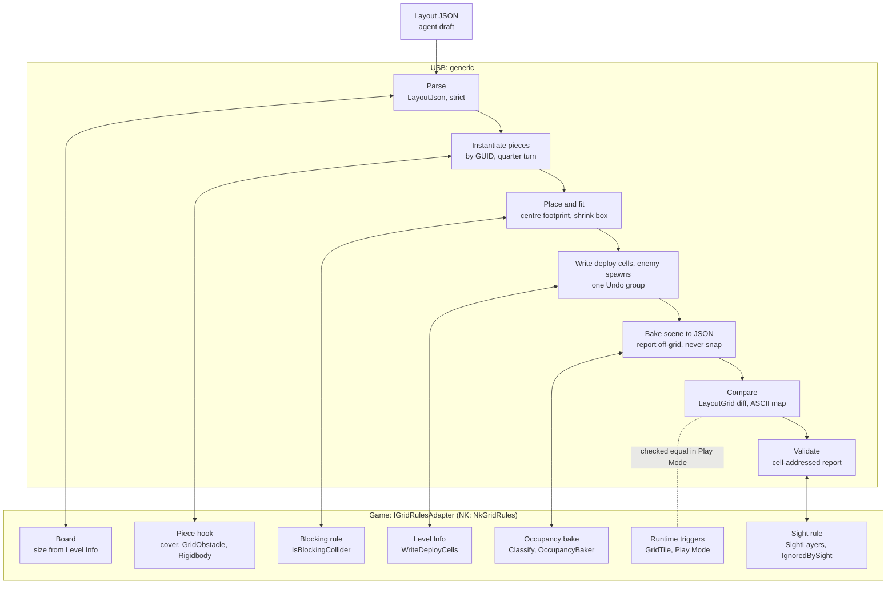

# Grid layouts: apply and bake

USB can turn a compact layout draft into scene objects (`LayoutApplier`), read
any scene back into the same draft (`LayoutBaker`, the `bake_layout` MCP tool), and
validate either (`LayoutValidator`, `LayoutSceneValidator`). USB
owns the generic parts. The game supplies its grid rules through one interface,
`IGridRulesAdapter`. Nuclear Knights' `NkGridRules` is the first implementation.
The JSON is the agent's working copy of a level; apply writes it into the scene and
the level asset, which stay the runtime sources of truth. When they disagree, re-bake
the JSON from the scene; a stale JSON is never trusted or merged (plan decision D9).
Background and later phases are in the
[asset intelligence plan](asset-intelligence-plan.md).

## Layout JSON

```json
{"v":1,"size":[12,12],
 "pieces":[["wall_n","215a18edfee7f4f2eaaa7fe488cea3ab",3,6,0]],
 "deploy":[[1,1],[2,1],[1,2]],
 "enemies":[["raider1","42e57b125c17a4bdab86d7879003f0e8","b0388b2498f234e91a73a49eec10add1",10,11,180]],
 "decor":[]}
```

- `size` must equal the game's board size.
- Each piece is `[localId, prefabGuid, x, y, rot]`: the prefab asset GUID, the
  min-corner cell of its footprint, and 0–3 clockwise quarter turns **on top of the
  prefab root's own rotation** (rot 0 places the prefab as authored).
- `pieces` block movement; `decor` never does. `deploy` replaces the level's deploy
  cells, in order.
- Each enemy is `[localId, profileGuid, visualGuid, x, y, facing]`: the game's unit
  profile and visual asset GUIDs, the spawn cell, and the facing in degrees (yaw:
  0 = +y, 90 = +x). `enemies` replaces the level's spawns, in order. Levels store no
  ids, so a bake names spawns `enemy1`, `enemy2`, … and `LayoutDocument.Diff` compares
  spawns by order, ignoring ids.
- Parsing is strict: unknown keys, malformed GUIDs, duplicate ids (shared by pieces,
  decor and enemies) and rotations outside 0–3 are errors, so a typo fails instead of
  applying a different level. Facing may be any number; the encounter validator
  checks it.

## Who owns what

| | USB (generic) | Game adapter (NK: `NkGridRules`) |
|---|---|---|
| Data | `Cell`, `LayoutDocument`, `LayoutJson` (`Runtime/Layout/`) | |
| Rules | `GridRules` as data; `LayoutGrid` applies them (neighbours, corner rule, orthogonal cover, diffs, ASCII map) | Supplies the values: cell size, 8-way, no corner-cutting, orthogonal cover |
| Board | | `TryGetBoard`, `CellToWorld`, `WorldToCell` (size from Level Info, origin, floor height) |
| Pieces | `LayoutApplier`: instantiate, rotate, measure, place, fit colliders, one Undo step | `DescribeCover`, `ConfigurePiece` (piece hook), `IsBlockingCollider` |
| Reading scenes | `LayoutBaker`: pieces, decor, off-grid reports, occupancy diff | `Classify` (blocker, decor, ignore), `BakeOccupancy` |
| Level data | Writes/reads deploy cells and enemy spawns through the adapter | `ReadDeployCells`, `WriteDeployCells`, `ReadEnemySpawns`, `WriteEnemySpawns` (resolves GUIDs to the game's asset types) |
| Validators | `LayoutValidator` (pure: structural, encounter, reachability, consistency), `LayoutReport`; `LayoutSceneValidator` (Editor: physics tier) | Nothing new: rules, occupancy bake and sight rules above |
| Sight | Consistency check: sight colliders without obstacles | `SightLayers`, `IgnoredBySight` |

`Runtime/Layout/` uses no UnityEngine types except `IGridRulesAdapter.cs`. The
runtime assembly is auto-referenced, so a game without asmdefs implements the
interface in Assembly-CSharp. USB Editor finds the single implementation through
`TypeCache`, so USB has no apply-time reference to the game. The adapter restates
rules the game already has. Keep a game-side harness that checks the restatement
against the real code; NK's is **Tools → Grid Combat → Validate Layout Round Trip**.

## Flow



Solid links are USB calling the adapter. The dotted link is the Play Mode check:
the game's own runtime occupancy must equal the layout.

## How the applier instantiates pieces

`LayoutApplier.Apply(document, scene, adapter)` (`Editor/Layout/LayoutApplier.cs`):

1. **Checks first.** It refuses during Play Mode and when the layout's size differs
   from the board. It resolves every GUID (`AssetDatabase.GUIDToAssetPath`, then
   load, then check it is a prefab) and throws once, listing all missing pieces,
   before touching the scene. Pieces moved between projects must keep their GUIDs.
2. **Root.** It opens one Undo group, removes any existing `[Generated Layout]` root
   (with Undo), and creates a fresh one with `Pieces` and `Decor` children.
3. **Per piece:**
   1. `PrefabUtility.InstantiatePrefab` creates a live prefab instance, so later
      prefab edits carry through. It is named by local id.
   2. Rotation is the quarter turn × the prefab root's own rotation.
   3. Blockers only: the adapter reports cover (`DescribeCover`) and runs the piece
      hook (`ConfigurePiece`). NK leaves its own obstacle prefabs as authored and adds
      `GridObstacle` plus a kinematic Rigidbody to others.
   4. Measure: the blocking colliders' bounds for blockers, renderer bounds for decor.
      Bounds are taken in the piece's quarter-turn frame, relative to its pivot, with
      all scales applied. This comes after the hook, which may add the collider.
   5. Footprint: the size is rounded up to whole cells after a 5 cm tolerance; odd
      quarter turns swap width and depth.
   6. Position: the adapter gives the world centres of the footprint's first and last
      cells; the measured centre (not the pivot) is placed at their midpoint, at the
      adapter's floor height. Off-centre pivots are corrected this way.
   7. Blockers only: each axis-aligned `BoxCollider` that reaches past the footprint is
      shrunk to the footprint inset by 0.1 m per side, as a scene override on the
      instance. Other collider shapes that overhang are reported (`FIT_UNSUPPORTED`).
4. **Finish.** It derives the expected grid from the recorded footprints (reporting
   `OVERLAP`, `OUT_OF_BOUNDS`, deploy problems), writes enemy spawns and deploy cells
   through the adapter with Undo recorded on the level, registers the root for Undo and
   collapses everything into one step. Before touching the scene it checks that every
   spawn GUID names an asset; if anything still throws later (e.g. the adapter refuses
   a GUID of the wrong asset type), it destroys the new root and reverts the Undo group,
   so the previous root and level come back unchanged.

The result lists issues (where the scene may not match the layout) and notes
(deliberate adjustments, e.g. `FIT 3,6 wall_n/.: 1.00 x 3.91 m -> 1.00 x 3.80 m`).
Reapplying replaces only the generated root; hand edits to generated objects are
lost on the next apply.

## How the baker reads a scene

`LayoutBaker.Bake(scene, adapter)` and `bake_layout(path=None)`:

- Visits active outermost prefab instances. The adapter classifies each as blocker,
  decor or ignored. Decor wholly off the board is skipped silently.
- Each instance must be a quarter turn of its prefab's rotation, at the prefab's
  scale, with its footprint centre within 5 cm of cell alignment and inside the board.
  Otherwise it is reported (`OFFGRID_ROTATION`, `OFFGRID_SCALE`, `OFFGRID_POSITION`,
  `OFF_BOARD`) and left out; nothing is snapped. Blocking colliders outside any prefab
  instance are reported as `NOT_PREFAB`.
- Deploy cells and enemy spawns come from the level through the adapter. A spawn
  without a profile or visual asset is reported (`ENEMY_NO_ASSET`) and left out.
- It then runs the adapter's occupancy bake and lists cells where the layout's
  footprints and the game disagree (`EXTRA_BLOCK`, `MISSING_BLOCK`, `COVER`).
- `bake_layout` only reads, unless `path` is given; then it writes that one `.json`
  file under `Assets/`. It is refused during Play Mode.

## Validators

`LayoutValidator` (`Runtime/Layout/LayoutValidator.cs`) is pure C#. Each check returns
`LayoutIssue`s, printed as `CODE x,y message` with an `Error` or `Warning` severity.
`LayoutReport.Format(maxLines = 40, ascii = false)` lists errors, then warnings, caps
the lines (`... N more lines not shown`), and on request appends the ASCII map
(`#` full, `h` half, `o` blocked, `.` open, `A` deploy, `E` enemy, `!` a unit on a
blocker, `-` open but unreachable).

| Check | Codes | Input |
|---|---|---|
| Structural | `OUT_OF_BOUNDS`, `OVERLAP` (one blocker per cell), `UNKNOWN_PIECE`, `DECOR_OUT_OF_BOUNDS` (warning); for scenes also the bake's `OFFGRID_*`, `OFF_BOARD`, `NOT_PREFAB` and the apply's `FIT_*`, `NO_BLOCKING_COLLIDER` | Document + footprints |
| Encounter | `DEPLOY_`/`ENEMY_OUT_OF_BOUNDS`, `DEPLOY_`/`ENEMY_BLOCKED`, `CELL_SHARED`, `FACING_RANGE` (outside 0–359), `FACING_OFF_AXIS` (warning: not one of the eight grid directions) | Occupancy grid, deploy, spawns |
| Reachability | `NO_DEPLOY`, `ENEMY_UNREACHABLE`, `POCKET` (warning, one per unreached region of open cells, at its lowest cell) | Breadth-first search from the open deploy cells with `LayoutGrid.CanStep` (the game's neighbour and corner rule) |
| Consistency | `MISSING_BLOCK` (a layout blocker without a game collider), `EXTRA_BLOCK`, `COVER`, `SIGHT_NO_OBSTACLE` (warning) | Layout grid, the game's occupancy bake, sight colliders |

Pieces must sit on whole cells (plan decision D10). Relaxing that for decor or
overhanging blockers comes later.

`LayoutSceneValidator` (`Editor/Layout/`) adds the physics tier:

- `ValidateApplied(document, applyResult, scene)`: structural, encounter and
  reachability on the draft's footprints, the apply's placement issues, the adapter's
  occupancy bake issues, then consistency.
- `ValidateScene(scene, bake = null)`: any scene. The bake's report lines are the
  structural tier; encounter and reachability run on the game's own occupancy bake,
  because pieces the layout cannot express still block at runtime.
- `GatherSight`: for each board cell, an overlap box across the sight band (0.5–2.5 m
  above the floor) on `SightLayers`, triggers and `IgnoredBySight` colliders excluded.
  Colliders are grouped by their outermost prefab instance (or GameObject); a group
  is an obstacle when a collider is a blocking collider or the instance classifies as
  a blocker. Others become `SIGHT_NO_OBSTACLE`, e.g. NK GridBattle's sandy rock sets.
  Non-convex mesh colliders are found only where their surface crosses a cell.

NK's checks against real content are in **Tools → Grid Combat → Validate Layout
Reports**: applied LayoutTest gives a clean report, broken JSON fixtures report exactly
their expected lines, and a GridBattle report equals a recorded fixture.

## Current limits

- Footprints are measured on each instance at its prefab scale. The Phase 4 catalog
  cards ([level catalog](level-catalog.md)) now exist and compute footprints on request;
  apply and bake switch to them, with the approved `placementScale`, in Phase 4c.
- `apply_layout` and `validate_layout` are not MCP tools yet (Phase 5); call `LayoutApplier.Apply`
  from an Editor menu or script (NK: **Tools → Grid Combat → Apply LayoutTest
  Layout**).
- Only axis-aligned box colliders are fitted. The applier does not check that a
  collider touches every footprint cell; the consistency check (`MISSING_BLOCK`) and
  the bake's occupancy diff catch that.
- Plausibility (roads, building fronts) and scale validators wait for the Phase 4
  catalog cards.

## Tests

- `Tests/Editor/LayoutModelTests.cs`: NUnit tests for the parser (enemies included),
  serializer, diffs, footprints, neighbour/corner rule, cover and ASCII map.
- `Tests/Editor/LayoutValidatorTests.cs`: deliberately broken layouts, each with the
  exact report line it must produce, plus corner-rule sealing, report capping and the
  map, and the consistency check. Run both through `TestProject`:
  `scripts/test-unity.sh -testFilter "Gamenami.UnitySemanticBridge.Editor.Tests.LayoutModelTests|Gamenami.UnitySemanticBridge.Editor.Tests.LayoutValidatorTests"`.
- `mcp-editor-bridge/tests/test_layout_tools.py`: `bake_layout` registration.
- Game side (NK): **Validate Layout Round Trip** compares the adapter's neighbour rule
  with `GridMap` and round-trips a fixture layout (pieces, deploy cells, enemy spawns)
  through apply and bake in a temporary scene; **Validate Layout Reports** checks
  the validators against NK content.
