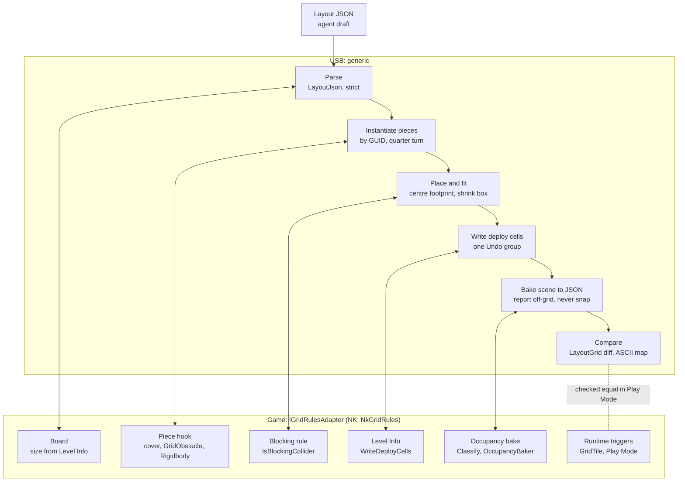

# Grid layouts: compile and bake

USB can turn a compact layout draft into scene objects (`LayoutCompiler`) and read
any scene back into the same draft (`LayoutBaker`, the `bake_layout` MCP tool). USB
owns the generic parts. The game supplies its grid rules through one interface,
`IGridRulesAdapter`. Nuclear Knights' `NkGridRules` is the first implementation.
The scene stays the source of truth; the JSON is the agent's draft and interchange
format. Background and later phases are in the
[asset intelligence plan](asset-intelligence-plan.md).

## Layout JSON

```json
{"v":1,"size":[12,12],
 "pieces":[["wall_n","215a18edfee7f4f2eaaa7fe488cea3ab",3,6,0]],
 "deploy":[[1,1],[2,1],[1,2]],
 "decor":[]}
```

- `size` must equal the game's board size.
- Each piece is `[localId, prefabGuid, x, y, rot]`: the prefab asset GUID, the
  min-corner cell of its footprint, and 0–3 clockwise quarter turns **on top of the
  prefab root's own rotation** (rot 0 places the prefab as authored).
- `pieces` block movement; `decor` never does. `deploy` replaces the level's deploy
  cells, in order.
- Parsing is strict: unknown keys, malformed GUIDs, duplicate ids and rotations
  outside 0–3 are errors, so a typo fails instead of compiling a different level.

## Who owns what

| | USB (generic) | Game adapter (NK: `NkGridRules`) |
|---|---|---|
| Data | `Cell`, `LayoutDocument`, `LayoutJson` (`Runtime/Layout/`) | |
| Rules | `GridRules` as data; `LayoutGrid` applies them (neighbours, corner rule, orthogonal cover, diffs, ASCII map) | Supplies the values: cell size, 8-way, no corner-cutting, orthogonal cover |
| Board | | `TryGetBoard`, `CellToWorld`, `WorldToCell` (size from Level Info, origin, floor height) |
| Pieces | `LayoutCompiler`: instantiate, rotate, measure, place, fit colliders, one Undo step | `DescribeCover`, `ConfigurePiece` (piece hook), `IsBlockingCollider` |
| Reading scenes | `LayoutBaker`: pieces, decor, off-grid reports, occupancy diff | `Classify` (blocker, decor, ignore), `BakeOccupancy` |
| Level data | Writes/reads deploy cells through the adapter | `ReadDeployCells`, `WriteDeployCells` |
| Sight | (Phase 3 physics tier) | `SightLayers`, `IgnoredBySight` |

`Runtime/Layout/` uses no UnityEngine types except `IGridRulesAdapter.cs`. The
runtime assembly is auto-referenced, so a game without asmdefs implements the
interface in Assembly-CSharp. USB Editor finds the single implementation through
`TypeCache`, so USB has no compile-time reference to the game. The adapter restates
rules the game already has. Keep a game-side harness that checks the restatement
against the real code; NK's is **Tools → Grid Combat → Validate Layout Round Trip**.

## Flow



Solid links are USB calling the adapter. The dotted link is the Play Mode check:
the game's own runtime occupancy must equal the layout.

## How the compiler instantiates pieces

`LayoutCompiler.Compile(document, scene, adapter)` (`Editor/Layout/LayoutCompiler.cs`):

1. **Checks first.** It refuses during Play Mode and when the layout's size differs
   from the board. It resolves every GUID (`AssetDatabase.GUIDToAssetPath`, then
   load, then check it is a prefab) and throws once, listing all missing pieces,
   before touching the scene. Pieces moved between projects must keep their GUIDs.
2. **Root.** It opens one Undo group, removes any existing `[Generated Layout]` root
   (with Undo), and creates a fresh one with `Pieces` and `Decor` children.
3. **Per piece:**
   1. `PrefabUtility.InstantiatePrefab` creates a live prefab instance, so later
      prefab edits carry through. It is named by local id.
   2. Rotation is the quarter turn × the prefab root's own rotation.
   3. Blockers only: the adapter reports cover (`DescribeCover`) and runs the piece
      hook (`ConfigurePiece`). NK leaves its own obstacle prefabs as authored and adds
      `GridObstacle` plus a kinematic Rigidbody to others.
   4. Measure: the blocking colliders' bounds for blockers, renderer bounds for decor.
      Bounds are taken in the piece's quarter-turn frame, relative to its pivot, with
      all scales applied. This comes after the hook, which may add the collider.
   5. Footprint: the size is rounded up to whole cells after a 5 cm tolerance; odd
      quarter turns swap width and depth.
   6. Position: the adapter gives the world centres of the footprint's first and last
      cells; the measured centre (not the pivot) is placed at their midpoint, at the
      adapter's floor height. Off-centre pivots are corrected this way.
   7. Blockers only: each axis-aligned `BoxCollider` that reaches past the footprint is
      shrunk to the footprint inset by 0.1 m per side, as a scene override on the
      instance. Other collider shapes that overhang are reported (`FIT_UNSUPPORTED`).
4. **Finish.** It derives the expected grid from the recorded footprints (reporting
   `OVERLAP`, `OUT_OF_BOUNDS`, deploy problems), writes deploy cells through the
   adapter with Undo recorded on the level, registers the root for Undo and collapses
   everything into one step.

The result lists issues (where the scene may not match the layout) and notes
(deliberate adjustments, e.g. `FIT 3,6 wall_n/.: 1.00 x 3.91 m -> 1.00 x 3.80 m`).
Recompiling replaces only the generated root; hand edits to generated objects are
lost on the next compile.

## How the baker reads a scene

`LayoutBaker.Bake(scene, adapter)` and `bake_layout(path=None)`:

- Visits active outermost prefab instances. The adapter classifies each as blocker,
  decor or ignored. Decor wholly off the board is skipped silently.
- Each instance must be a quarter turn of its prefab's rotation, at the prefab's
  scale, with its footprint centre within 5 cm of cell alignment and inside the board.
  Otherwise it is reported (`OFFGRID_ROTATION`, `OFFGRID_SCALE`, `OFFGRID_POSITION`,
  `OFF_BOARD`) and left out; nothing is snapped. Blocking colliders outside any prefab
  instance are reported as `NOT_PREFAB`.
- It then runs the adapter's occupancy bake and lists cells where the layout's
  footprints and the game disagree (`EXTRA_BLOCK`, `MISSING_BLOCK`, `COVER`).
- `bake_layout` only reads, unless `path` is given; then it writes that one `.json`
  file under `Assets/`. It is refused during Play Mode.

## Current limits

- Footprints are measured on each instance at its prefab scale. Phase 4 catalog cards
  will supply bounds and an approved `placementScale` instead.
- `compile_layout` is not an MCP tool yet (Phase 5); call `LayoutCompiler.Compile`
  from an Editor menu or script (NK: **Tools → Grid Combat → Compile LayoutTest
  Layout**).
- Only axis-aligned box colliders are fitted. The compiler does not check that a
  collider touches every footprint cell; the bake's occupancy diff catches that.

## Tests

- `Tests/Editor/LayoutModelTests.cs`: NUnit tests for the parser, serializer, diffs,
  footprints, neighbour/corner rule and cover (run through `TestProject`).
- `mcp-editor-bridge/tests/test_layout_tools.py`: `bake_layout` registration.
- Game side (NK): **Validate Layout Round Trip** compares the adapter's neighbour rule
  with `GridMap` and round-trips a fixture layout through compile and bake in a
  temporary scene.
